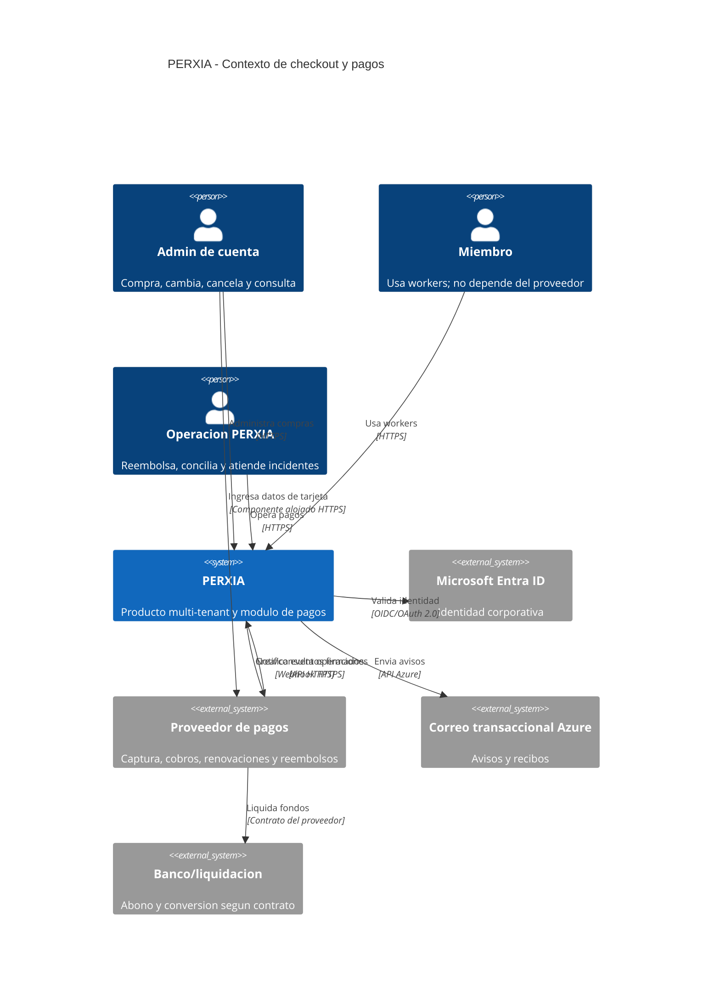
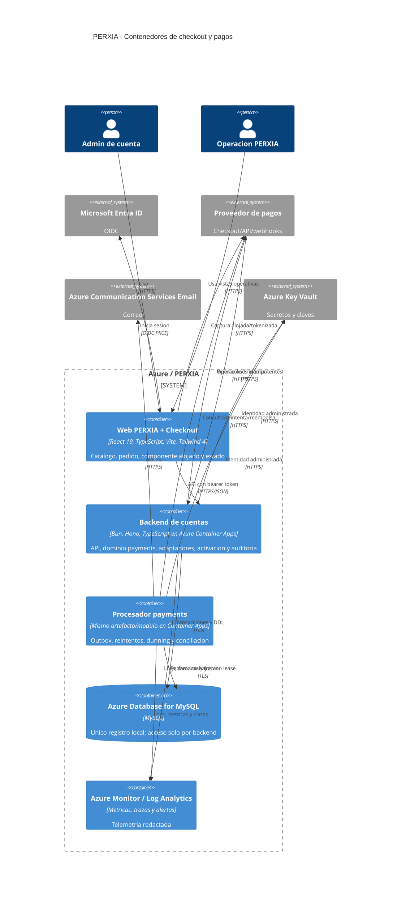
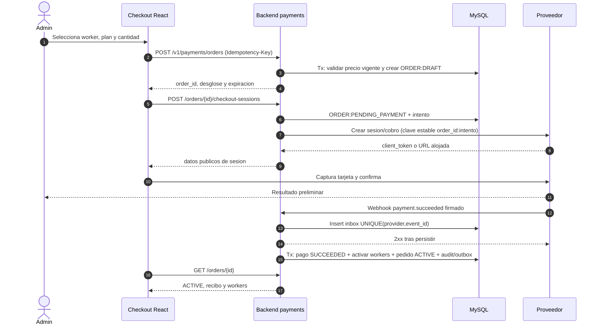
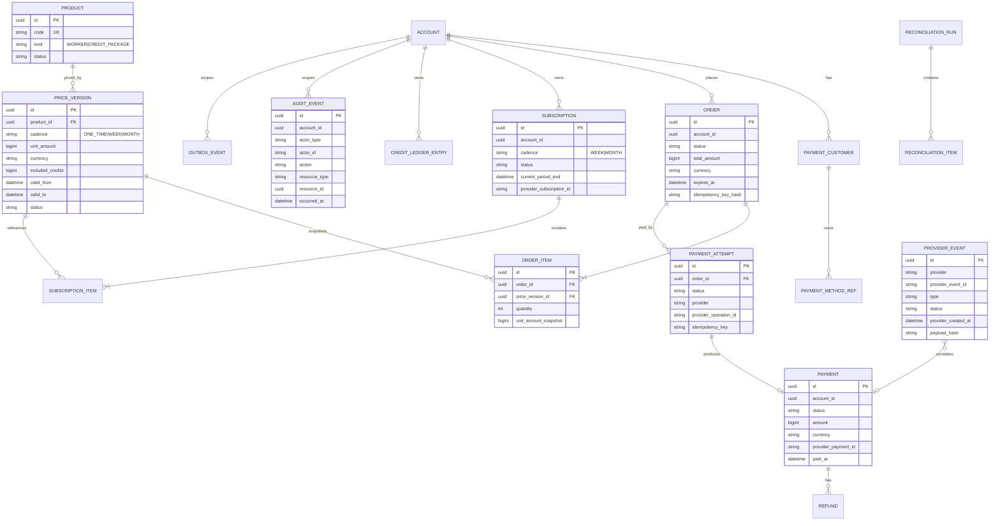
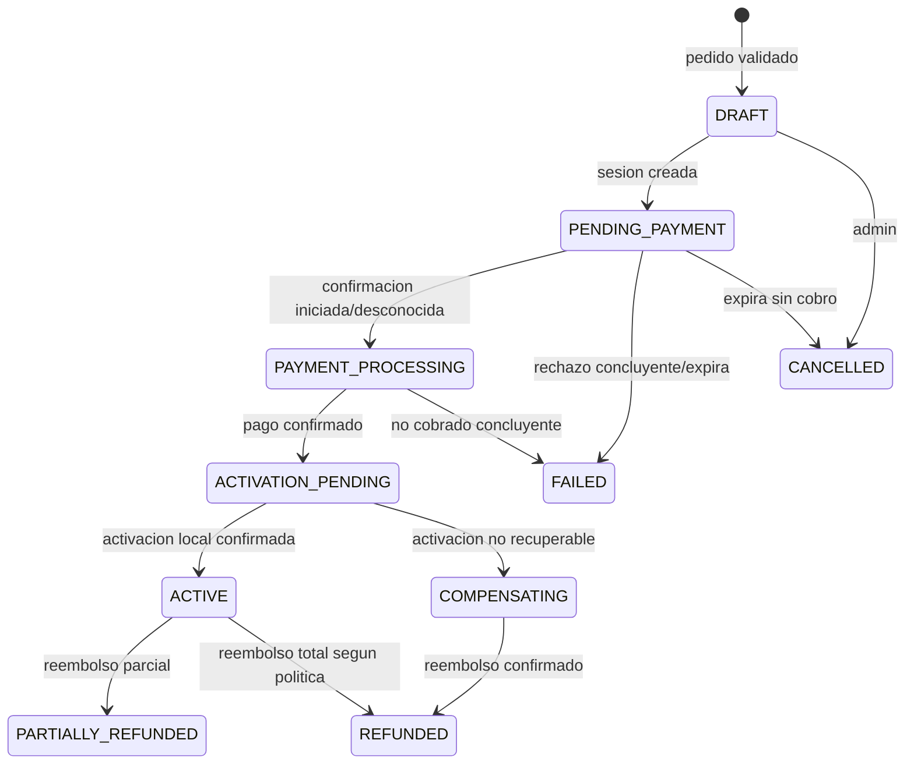
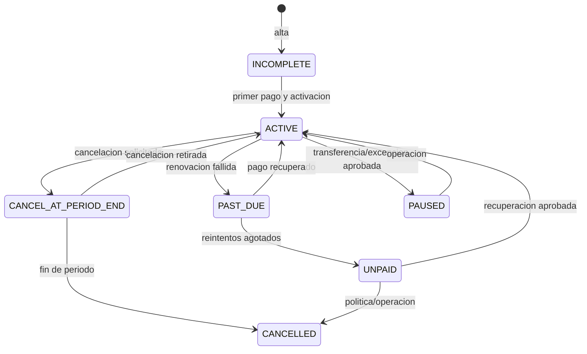

# Propuesta tecnica: checkout y pasarela de pagos PERXIA

| Campo | Valor |
|---|---|
| Alcance | Propuesta solicitada en PRD 12.1 |
| Estado | Para revision; no constituye implementacion ni aprobacion comercial/legal |
| Fecha base | 2026-10-28 |
| Moneda | USD; importes almacenados en unidades menores enteras |
| Decision de proveedor | Condicionada a DP-1 y a validacion contractual |

## 0. Resumen ejecutivo

Se propone una pagina React integrada al producto y un modulo `payments` dentro del backend de cuentas Bun/Hono. El modulo es el unico propietario del acceso a MySQL para pagos, orquesta el proveedor mediante un puerto interno, procesa webhooks, activa workers y creditos en transacciones locales, ejecuta dunning y conciliacion, y deja auditoria solo-insercion. El navegador captura la tarjeta exclusivamente con checkout o componentes alojados por el proveedor.

No existe una transaccion atomica distribuida entre MySQL y un proveedor externo. Por tanto, "pago y activacion atomicos" se implementa como una saga durable: idempotencia, estados intermedios visibles, reintento de activacion y reembolso compensatorio si no se puede converger. Puede existir temporalmente `ACTIVATION_PENDING`; el invariante final es que todo pago confirmado termina activado o compensado. Los webhooks son entrega **al menos una vez**, pueden duplicarse y llegar fuera de orden; "procesar exactamente una vez" significa efectos de negocio idempotentes, no entrega exactamente una vez.

Stripe no esta disponible para cuentas mercantiles ordinarias domiciliadas en Colombia. No se debe abrir una cuenta Stripe declarando una entidad o domicilio que no correspondan. Si DP-1 mantiene a Periferia IT Group Colombia como comerciante, se recomienda iniciar una validacion comercial corta con **PayU Colombia como candidato primario** y dLocal como respaldo. La documentacion publica confirma integracion y procesamiento en Colombia y enumera USD, pero recurrencia, cobro efectivo en USD para esta cuenta, liquidacion a Colombia en USD/COP, checkout alojado compatible con SAQ A, costos y SLA quedan **por verificar contractualmente**. Stripe solo es candidato si se aprueba y opera realmente una entidad en un pais soportado, con sus obligaciones bancarias, fiscales y contables.

Una cuenta con workers semanales y mensuales se representa con dos calendarios/suscripciones independientes. En particular, **semana + mes no se modelara como una sola suscripcion Stripe de intervalo mixto**: se considera no soportado para este diseno y no portable entre proveedores. Esta separacion tambien aisla fallos, renovaciones y cambios por cadencia.

## 1. Alcance, supuestos y decisiones pendientes

### 1.1 Alcance de esta propuesta

Incluye arquitectura, flujos normales y de fallo, modelo de dominio y datos, API, seguridad, evaluacion de proveedor, ADR, tecnologia, pruebas, operacion, plan y riesgos para FR-1 a FR-14. Identifica, pero no implementa, impuestos y facturacion electronica. No afirma que existan credenciales, contratos, cuentas sandbox ni infraestructura desplegada.

### 1.2 Supuestos explicitamente no aprobados

| ID | Supuesto de trabajo | Consecuencia si cambia |
|---|---|---|
| A-1 | El backend actual puede incorporar tablas, rutas y un procesador asincrono del mismo modulo. | Si no puede, se reestima integracion; no se crea otro propietario de datos. |
| A-2 | Entra ID entrega `account_id`, sujeto y roles verificables por el backend; solo `account_admin` compra y `payments_operator` reembolsa. | Se requiere trabajo previo de roles/claims. |
| A-3 | El servicio existente de workers expone una operacion interna idempotente o puede incorporarla en la misma transaccion MySQL. | Si solo existe HTTP no transaccional, se usa otra saga y aumenta la ventana de convergencia. |
| A-4 | Un precio aceptado queda congelado en el pedido; cambios posteriores aplican solo segun politica comercial. | Se debe definir migracion de precio por suscripcion. |
| A-5 | Una semana equivale a un intervalo recurrente de 7 dias desde el ancla, no a semana calendario. | Otra definicion cambia calendarios y pruebas. |
| A-6 | Disponibilidad objetivo inicial del modulo: 99.9% mensual; API p95 menor a 2 s, excluyendo UI/redirect del proveedor. **Propuesta**. | Cambian capacidad, SLA y costo. |
| A-7 | Retencion: registros financieros/auditoria 10 anos y payload de webhook cifrado 30 dias. **Propuesta, validar con legal y privacidad**. | Ajustar purga, costos y evidencia. |
| A-8 | Equipo de estimacion: 2 desarrolladores full-stack, 1 QA al 50%, apoyo puntual de DevOps, Seguridad, UX y Operacion. | Las fechas escalan con disponibilidad y tiempos del proveedor. |
| A-9 | Bajas/cancelaciones surten efecto al fin del periodo y altas no prorratean hasta DP-2. | El motor de cambios se ajusta al cerrar DP-2. |
| A-10 | La activacion no espera el redirect del navegador: el webhook o consulta autoritativa del proveedor decide. | Evita activar por respuesta manipulable o pestana cerrada. |

### 1.3 DP-1 a DP-7: pendientes y compuertas

| ID | Pendiente | Tratamiento provisional | Compuerta |
|---|---|---|---|
| DP-1 | Entidad legal y pais de cobro | Periferia Colombia; Stripe no viable. Evaluar PayU/dLocal. | Debe cerrarse antes de contratar y de fase 2. |
| DP-2 | Prorrateo, cambio de cadencia, renovacion semanal y precios | Sin prorrateo; baja al fin del periodo; semanal auto-renovable; precios requieren aprobacion versionada. **Propuesta**. | Antes de cambios de cantidad/plan. |
| DP-3 | Paquetes y precios de creditos extra | Modelo preparado, catalogo no publicable. | Antes de habilitar compra de creditos. |
| DP-4 | Bolsa del worker semanal | Campo obligatorio de la version de precio, sin valor supuesto. | Antes de vender plan semanal. |
| DP-5 | Politica de impago | 7 dias de gracia, avisos, bloqueo de nuevas compras, sin corte automatico. **Propuesta**. | Antes de renovaciones productivas. |
| DP-6 | Facturacion electronica e impuestos | Guardar identidad fiscal, subtotal/impuestos/desglose opcionales y referencias documentales; no emitir. | Contabilidad valida antes de produccion. |
| DP-7 | Transferencias | Estado `EXTERNAL_SETTLEMENT`; activacion solo por Operacion con evidencia y auditoria. **Propuesta**. | Antes de migrar cuentas actuales. |

Ningun supuesto anterior sustituye una decision DP. La fase 0 produce actas firmadas o mantiene deshabilitada la funcion afectada mediante configuracion.

## 2. Arquitectura

### 2.1 C4 nivel 1: contexto



PERXIA es sistema de registro de pedidos, derechos de uso, auditoria y conciliacion. El proveedor es sistema de registro del movimiento financiero; una discrepancia abre una excepcion de conciliacion, no se corrige silenciosamente. Entra autentica personas, pero el backend resuelve y aplica tenant/rol. El uso cotidiano de workers no consulta al proveedor.

### 2.2 C4 nivel 2: contenedores



`worker` es una unidad de ejecucion del mismo backend y modulo, no un segundo servicio ni propietario de datos. Puede ejecutarse como replica dedicada o Azure Container Apps Job. Si es Job, usa la misma identidad administrada, artefacto, reglas y capa de datos del backend. Los trabajos se reclaman en MySQL con lease; no se agrega una cola hasta que volumen o aislamiento lo justifiquen.

### 2.3 Responsabilidades

| Pieza | Responsabilidad | No hace |
|---|---|---|
| Checkout | Presenta catalogo vigente, calcula una previsualizacion no autoritativa, inicia sesion del proveedor, muestra estado consultando API. | No fija precio final, no activa, no almacena tarjeta. |
| API `payments` | Autoriza tenant/rol, recalcula precio, crea pedidos e idempotencia, adapta proveedor, registra eventos y ejecuta transacciones de activacion. | No confia en totales del cliente ni en redirects. |
| Adaptador de proveedor | Traduce capacidades/estados, firma solicitudes, verifica webhooks y normaliza errores. | No contiene reglas de workers ni expone objetos del proveedor al dominio. |
| Procesador | Consume inbox/outbox, recupera operaciones inciertas, concilia, reintenta activacion, dunning y correo. | No crea cobros sin clave idempotente. |
| MySQL | Estado local, precios versionados, ledger, inbox/outbox y auditoria. | No almacena PAN, CVV ni secretos. |
| Proveedor | Captura/tokeniza, autoriza/captura, renueva, reembolsa y emite recibo si se contrata. | No decide derechos de uso PERXIA. |

## 3. Flujos de secuencia y consistencia

### 3.1 Compra inicial exitosa



El `Idempotency-Key` del cliente evita pedidos repetidos por doble clic. La clave enviada al proveedor deriva de una operacion persistida, nunca de una solicitud transitoria. Un resultado visual del proveedor no activa nada; si el webhook tarda, el backend consulta por referencia y el UI muestra `PROCESSING`.

### 3.2 Webhook duplicado o fuera de orden

```mermaid
sequenceDiagram
  participant P as Proveedor
  participant B as Backend payments
  participant D as MySQL
  participant J as Procesador

  P->>B: event E42 payment.succeeded + firma
  B->>B: Verificar firma sobre body crudo y tolerancia temporal
  B->>D: INSERT provider_event(provider,E42)
  D-->>B: Insertado
  B-->>P: 204
  P->>B: event E42 duplicado
  B->>D: INSERT provider_event(provider,E42)
  D-->>B: Conflicto UNIQUE
  B-->>P: 204 (ya recibido)
  P->>B: event anterior payment.pending llega tarde
  B->>D: Insert E41
  B-->>P: 204
  J->>D: Reclamar E42/E41
  J->>P: Consultar estado autoritativo cuando el orden es ambiguo
  P-->>J: succeeded, referencia y monto
  J->>D: Transicion monotona e idempotente; efectos una vez
```

No se ordena solo por hora del evento. Se aplican transiciones permitidas, se compara version/referencia si existe y, ante regresion o hueco, se recupera el recurso actual del proveedor. El evento duplicado queda contabilizado, pero no repite activacion, credito, correo ni auditoria de negocio.

### 3.3 Pago confirmado y activacion fallida

```mermaid
sequenceDiagram
  participant P as Proveedor
  participant B as Backend payments
  participant D as MySQL
  participant J as Procesador
  participant O as Operacion

  P->>B: payment.succeeded
  B->>D: Persistir inbox
  B-->>P: 204
  J->>D: Tx pago SUCCEEDED + activar workers
  D--xJ: Deadlock/regla/dependencia falla; rollback total local
  J->>D: Pedido ACTIVATION_PENDING, intento y error sanitizado
  loop Reintentos con backoff y misma activation_key
    J->>D: Tx idempotente de activacion
    D-->>J: Falla recuperable
  end
  alt Se recupera antes del limite
    J->>D: Tx: workers + ORDER ACTIVE + audit/outbox
  else Error permanente o vence SLO
    J->>P: Refund con clave compensatoria estable
    P-->>J: refund pending/succeeded
    J->>D: ORDER COMPENSATING; registrar refund
    J-->>O: Alerta y caso operativo
  end
```

SLO propuesto: primer reintento inmediato, luego 1, 5, 15 y 60 minutos; escalar a los 15 minutos y compensar automaticamente a las 2 horas solo para errores clasificados permanentes o tras aprobacion de politica. Un timeout del reembolso deja `COMPENSATING`, nunca se interpreta como exito. La conciliacion cierra el resultado.

### 3.4 Proveedor caido a mitad de compra

```mermaid
sequenceDiagram
  actor A as Admin
  participant W as Checkout
  participant B as Backend
  participant D as MySQL
  participant P as Proveedor
  participant J as Procesador

  W->>B: Crear sesion de checkout
  B->>D: Persistir PAYMENT_ATTEMPT:CREATING y clave K
  B->>P: Crear operacion con K
  P--xB: Timeout (resultado desconocido)
  B->>D: ATTEMPT:UNKNOWN
  B-->>W: 202 PAYMENT_PROCESSING; no crear otro cobro
  J->>P: Consultar por K/referencia
  alt El proveedor si creo/cobro
    P-->>J: Estado y objeto existente
    J->>D: Vincular y continuar saga
  else Confirma inexistencia
    P-->>J: Not found concluyente
    J->>P: Repetir create con la misma K
  else Sigue caido
    J->>D: Mantener UNKNOWN y reintentar con backoff
    J-->>A: Aviso; no afirmar fallo ni exito
  end
```

No se permite "intentar otra vez" con una clave nueva mientras el resultado sea desconocido. El checkout conserva el pedido y permite refrescar estado. Si falla antes de entregar una sesion, no hay activacion; si el cliente ya confirmo, webhooks y consulta autoritativa recuperan el desenlace.

### 3.5 Renovacion fallida

```mermaid
sequenceDiagram
  participant P as Proveedor
  participant B as Backend
  participant D as MySQL
  participant J as Procesador
  participant M as Correo
  actor A as Admin

  P->>B: renewal.payment_failed (attempt 1)
  B->>D: Inbox durable
  B-->>P: 204
  J->>D: Payment FAILED + subscription PAST_DUE + dunning case
  J->>M: Aviso con enlace seguro para actualizar metodo
  M-->>A: Pago fallido; fecha de siguiente intento
  P->>B: payment_failed (intentos posteriores)
  B->>D: Actualizar intento idempotente
  alt Pago recuperado
    P->>B: payment.succeeded
    B->>D: Subscription ACTIVE + pago + audit
    J->>M: Confirmacion de recuperacion
  else Reintentos agotados
    J->>D: Subscription UNPAID; bloquear compras segun DP-5
    J->>M: Aviso final a admin y Operacion
    Note over D: No cortar workers automaticamente hasta aprobar DP-5
  end
```

La politica del proveedor se configura para no competir con el dunning local: el proveedor ejecuta los reintentos de cobro y notifica; PERXIA controla avisos, permisos y consecuencia de dominio. Si no ofrece scheduler recurrente adecuado, PERXIA agenda cargos tokenizados sin almacenar tarjeta, con la misma maquina de estados.

## 4. Dominio, datos y estados

### 4.1 Limites e invariantes

- Cada fila de negocio lleva `account_id`; claves y consultas incluyen tenant. Un recurso ajeno responde 404.
- Importes son `BIGINT` en unidad menor y `currency CHAR(3)`; nunca `FLOAT/DOUBLE`.
- El servidor recalcula importes con una `price_version`; el cliente no envia precio autoritativo.
- Cada pago, reembolso, activacion y credito tiene una clave idempotente unica por cuenta/operacion.
- Una version de precio publicada es inmutable y tiene vigencia `[valid_from, valid_to)`; no se borra si fue usada.
- El ledger financiero y el ledger de creditos son solo-insercion; correcciones son asientos compensatorios.
- `provider_id` es interno; IDs externos se guardan en tablas de referencia y no forman la API publica.
- Cero workers es valido. Una suscripcion sin items termina/cancela, no crea una cantidad ficticia.
- Los campos de proveedor se normalizan; datos especificos opcionales se aislan en `provider_metadata` cifrado/sanitizado.

### 4.2 Modelo logico



Tablas adicionales: `payment_customer`, `payment_method_ref` (unicamente ID tokenizado e identificador del proveedor; nunca PAN, CVV ni fecha de expiracion), `subscription_item`, `refund`, `credit_ledger_entry`, `outbox_event`, `dunning_case`, `reconciliation_run/item`, `provider_event_attempt` y `schema_migration`. Las relaciones con workers existentes se realizan mediante una `activation_key` y referencias a `order_item`; no se duplica el worker como entidad de pagos.

Indices minimos: `UNIQUE(provider, provider_event_id)`, `UNIQUE(provider, provider_payment_id)`, `UNIQUE(account_id, idempotency_key_hash, operation)`, `UNIQUE(activation_key)`, indices `(account_id, created_at)`, `(status, next_attempt_at)` y `(provider, provider_subscription_id)`. Las FK, checks de cantidad positiva y moneda comun por pedido son obligatorias. El DDL usa migraciones versionadas expand-only, checksum y verificacion de drift, y se aplica antes del codigo.

### 4.3 Estados y transiciones





Estados de `payment`: `PENDING -> PROCESSING -> SUCCEEDED|FAILED`; `SUCCEEDED -> PARTIALLY_REFUNDED -> REFUNDED`, o directo a `REFUNDED`; `UNKNOWN` exige consulta y no es fallo. No se admiten regresiones por eventos tardios. Reembolsos tienen su propia maquina `REQUESTED -> PROCESSING -> SUCCEEDED|FAILED|UNKNOWN`.

### 4.4 Modelo semanal y mensual

Una cuenta tiene como maximo una suscripcion activa por `provider + currency + cadence` y multiples items/quantities dentro de ella; en proveedores sin suscripciones nativas, es un calendario local equivalente. Semanal y mensual tienen anclas y facturas separadas. El estado de cuenta las agrega visualmente.

No se usa una suscripcion por worker porque multiplica facturas y fallos; tampoco una sola suscripcion mixta. En particular, **una combinacion semana + mes se trata como no soportada en una unica suscripcion Stripe de intervalo mixto** para esta solucion. Dos suscripciones permiten portabilidad, fechas claras y dunning independiente, a costa de potenciales cobros/recibos separados.

## 5. Contrato API

### 5.1 Convenciones

- Base `/v1/payments`; JSON UTF-8, fechas RFC 3339 UTC, IDs UUID opacos y moneda ISO 4217.
- Entra bearer token para usuario; el backend obtiene `account_id` y rol, nunca los acepta del body/query.
- `Idempotency-Key` obligatorio en todos los POST con efecto; 24-72 h de replay como minimo y hash del request para rechazar reutilizacion distinta.
- `ETag`/`If-Match` en cambios de suscripcion para evitar lost update.
- Correlation ID aceptado/generado en `X-Correlation-Id`; nunca contiene PII.
- Paginacion por cursor estable. Respuestas no exponen secretos ni payloads crudos del proveedor.

### 5.2 Rutas de cliente

| Metodo y ruta | Usuario | Funcion | Resultado principal |
|---|---|---|---|
| `GET /catalog?at=` | Admin | Productos y precios vigentes/versionados. | `200` catalogo; `ETag`. |
| `POST /orders` | Admin | Valida items, congela precio y crea pedido. | `201` pedido/desglose; `409 PRICE_CHANGED`. |
| `GET /orders/{orderId}` | Admin | Estado de compra/activacion. | `200`; 404 si no existe o es otro tenant. |
| `POST /orders/{orderId}/checkout-sessions` | Admin | Crea/reutiliza sesion alojada. | `201` URL/token publico y expiracion; `202` si incierto. |
| `POST /orders/{orderId}/cancel` | Admin | Cancela solo si aun no cobrado. | `200` o `409 INVALID_STATE`. |
| `GET /account-summary` | Admin | Metodo enmascarado, saldos, proximos cobros. | `200`, estados vacios incluidos. |
| `GET /payments` | Admin | Historial paginado. | `200`. |
| `GET /payments/{paymentId}/receipt` | Admin | URL firmada corta o redirect a recibo. | `302/200`; no URL permanente. |
| `POST /payment-method-sessions` | Admin | Sesion alojada para actualizar metodo. | `201`. |
| `GET /subscriptions` | Admin | Semanal/mensual, items y fechas. | `200`. |
| `PATCH /subscriptions/{id}` | Admin | Cantidades/cancelacion segun DP-2. | `202` cambio en proceso o `200`; requiere `If-Match`. |

Ejemplo de creacion; los precios enviados son referencias, no importes:

```json
{
  "items": [
    {"priceId": "prv_week_software_v3", "quantity": 2},
    {"priceId": "prv_month_quality_v2", "quantity": 1}
  ],
  "locale": "es"
}
```

Respuesta abreviada:

```json
{
  "id": "ord_01...",
  "status": "DRAFT",
  "currency": "USD",
  "amountDueNow": 369200,
  "renewals": [
    {"cadence": "WEEK", "amount": 69200, "nextAt": "2026-11-04T15:00:00Z"},
    {"cadence": "MONTH", "amount": 300000, "nextAt": "2026-11-28T15:00:00Z"}
  ],
  "expiresAt": "2026-10-28T15:30:00Z"
}
```

### 5.3 Rutas de sistema y Operacion

| Metodo y ruta | Consumidor | Control |
|---|---|---|
| `POST /webhooks/{provider}` | Proveedor | Sin Entra; firma, timestamp, limite de body y allowlist opcional no sustitutiva. |
| `POST /operations/payments/{id}/refunds` | Operacion | Rol privilegiado, step-up/MFA, motivo, idempotencia; reembolso parcial limitado al saldo. |
| `POST /operations/provider-events/{id}/replay` | Operacion | Reprocesa efecto idempotente; nunca altera payload. |
| `POST /operations/activation-jobs/{id}/retry` | Operacion | Rol y auditoria; misma `activation_key`. |
| `POST /operations/reconciliations` | Job/Operacion | Periodo cerrado, proveedor y clave idempotente. |
| `GET /operations/reconciliations/{id}` | Operacion | Diferencias y exportacion segura. |
| `POST /internal/jobs/tick` | Scheduler si aplica | Identidad administrada, red privada, no publico. |

### 5.4 Errores

Formato `application/problem+json`:

```json
{
  "type": "https://api.perxia.example/problems/price-changed",
  "title": "El precio cambio",
  "status": 409,
  "code": "PRICE_CHANGED",
  "detail": "Revise el resumen antes de continuar.",
  "traceId": "01...",
  "retryable": false
}
```

| HTTP | Codigo estable | Uso |
|---|---|---|
| 400 | `VALIDATION_ERROR`, `MIXED_CURRENCY` | Forma o regla invalida. |
| 401 | `UNAUTHENTICATED` | Token ausente/invalido. |
| 403 | `ROLE_REQUIRED` | Mismo tenant pero sin rol; no revela otros recursos. |
| 404 | `RESOURCE_NOT_FOUND` | Inexistente o perteneciente a otro tenant. |
| 409 | `PRICE_CHANGED`, `INVALID_STATE`, `IDEMPOTENCY_CONFLICT`, `VERSION_CONFLICT` | Conflicto recuperable por usuario. |
| 422 | `PAYMENT_DECLINED`, `CADENCE_NOT_AVAILABLE` | Rechazo concluyente/regla comercial. |
| 429 | `RATE_LIMITED` | Incluye `Retry-After`. |
| 502 | `PROVIDER_ERROR` | Fallo concluyente del upstream sin resultado financiero incierto. |
| 503 | `PROVIDER_UNAVAILABLE` | No iniciar; `Retry-After`. |
| 202 | `PAYMENT_PROCESSING` en body | No es error: resultado externo desconocido/en curso. |

Mensajes de cliente son localizables; `detail` no contiene codigos internos, PII ni texto crudo del proveedor. Errores del proveedor se mapean a categorias estables y el detalle completo sanitizado queda restringido a telemetria segura.

## 6. Seguridad, PCI y privacidad

### 6.1 PCI DSS

Objetivo: elegibilidad **SAQ A**, sujeta a validacion con el adquirente/QSA. PAN, CVV y fecha de expiracion se ingresan en pagina redirigida o iframe/componente servido directamente por el proveedor; no atraviesan DOM controlado, API, CDN logs, MySQL ni observabilidad de PERXIA. PERXIA guarda unicamente los identificadores del proveedor permitidos por el PRD.

Antes de seleccionar proveedor se exige Attestation of Compliance vigente, definicion escrita del SAQ aplicable, 3DS/SCA cuando corresponda, tokenizacion para cobro sin presencia y checkout alojado. Si una integracion requiere que el backend reciba PAN/CVV, se rechaza aunque su API sea mas flexible. Scripts de la pagina de pago se minimizan, fijan por CSP (`frame-src`, `script-src`, `connect-src`) y se inventarian; no se usan analytics/session replay sobre checkout.

### 6.2 Secretos y claves

- Claves API, secretos webhook y credenciales de correo viven en Azure Key Vault; el workload accede con Managed Identity/RBAC de minimo privilegio.
- Solo identificadores publicables del proveedor llegan al browser. Ninguna clave secreta, credencial de servidor de cuenta o secreto webhook se compila en Vite.
- Produccion, staging y desarrollo usan vaults, cuentas y webhooks separados. Credenciales sandbox no se reutilizan.
- Egress TLS 1.2+; MySQL exige TLS. Cifrado Azure en reposo y cifrado de aplicacion para payload temporal/metadata sensible.
- Rotacion soporta clave anterior y nueva durante una ventana controlada; version del secreto queda en metrica, no su valor.

### 6.3 Identidad, autorizacion y tenant

React usa OIDC Authorization Code + PKCE con Entra. Hono valida firma, issuer, audience, expiracion y scopes; resuelve `account_id` del contexto confiable del servidor. Se aplica RBAC por ruta y ownership por consulta. Operacion usa grupo Entra separado, MFA/Conditional Access y privilegio just-in-time recomendado. CSRF se mitiga con bearer tokens no enviados automaticamente; redirects usan `state`/`nonce` y URLs permitidas exactas.

### 6.4 Webhooks

Se conserva el body crudo en memoria solo para verificar HMAC/firma antes de parsear. Se valida timestamp con tolerancia propuesta de 5 minutos, endpoint/entorno, algoritmo vigente y longitud maxima. Despues se inserta inbox con restriccion unica y se responde 2xx rapidamente. Firma invalida responde 400 sin revelar causa; indisponibilidad de DB responde 5xx para provocar reintento. La IP, si el proveedor publica rangos, es defensa adicional, no autenticacion.

Como los webhooks son al menos una vez y fuera de orden, se deduplican por ID del proveedor y se reconcilian con consultas autoritativas. "Exactly once" se limita a efectos: constraints, transacciones, claves de activacion y outbox evitan duplicados.

### 6.5 Logging y privacidad

Nunca se registra: PAN, CVV, track, PIN, secreto/token, Authorization header, cookie, body crudo completo, URL de checkout, nombre/correo completo, direccion, documento fiscal completo ni respuesta sin filtrar del proveedor. Se registran IDs internos, proveedor, tipo/ID hash de evento, estado normalizado, importe/moneda si politica lo permite, duracion, intento, `traceId` y error categorizado. Redaccion se prueba y aplica antes del sink.

Ley 1581: finalidad, minimizacion, inventario, retencion/purga, acceso restringido, atencion de derechos y contrato de encargado/transferencia internacional deben revisarse. Auditoria financiera se seudonimiza donde sea posible. Exportaciones llevan control de acceso, marca temporal y expiracion.

Amenazas prioritarias: IDOR cross-tenant, manipulacion de precio/cantidad, replay de webhook, doble cobro por timeout, inyeccion de contenido del proveedor, abuso de reembolso y supply chain. Controles: resolucion server-side, recalculo, firma+nonce temporal, idempotencia+consulta, encoding/CSP, doble control operativo y lockfiles/SBOM/escaneo.

## 7. Viabilidad de proveedor para comerciante colombiano

### 7.1 Hecho bloqueante

La lista oficial de Stripe consultada por el PRD el 2026-10-14 y revisada para esta propuesta no incluye Colombia. Por ello, **Stripe no esta disponible para una cuenta mercantil ordinaria de Periferia IT Group domiciliada en Colombia**, aunque venda en USD. Stripe Atlas no habilita a la entidad colombiana: crea una entidad estadounidense distinta, con cuenta bancaria, impuestos, contabilidad, contratos intercompany, beneficiarios finales y costos propios. Mexico presenta implicaciones equivalentes. Solo Direccion, contador y abogado pueden aprobar esa estructura (DP-1).

### 7.2 Comparacion de candidatos

| Opcion | Comerciante Colombia | USD / liquidacion | Recurrencia | Integracion/PCI | Evaluacion |
|---|---|---|---|---|---|
| Stripe | No para cuenta colombiana ordinaria. | USD y payout dependen de entidad soportada. | Fuerte, pero semana+mes se separa en dos suscripciones; no una mixta. | Checkout/Elements, sandbox y webhooks maduros. | Descartado bajo DP-1 Colombia; viable solo con entidad real aprobada en pais soportado. |
| PayU Colombia | Documentacion y procesamiento Colombia confirmados. | Documentacion enumera USD; habilitacion para comercio colombiano, moneda de presentacion y liquidacion/cambio **por verificar**. | Tokenizacion/recobro y scheduler/intervalo semanal **por verificar contractualmente**. | WebCheckout/API, sandbox, confirmaciones; confirmar que el flujo elegido mantiene SAQ A. | Candidato primario por ajuste local y evidencia publica. |
| dLocal | Cobertura regional y modelo cross-border conocidos; onboarding de entidad colombiana **por verificar**. | Cobro USD, settlement, FX y reservas **por verificar** para este contrato. | Tokenizacion, merchant-initiated transactions y scheduler **por verificar**. | Hosted fields/checkout, sandbox y firma **por verificar en discovery**. | Respaldo/RFP, especialmente para ventas internacionales. |
| Wompi Colombia | Onboarding colombiano, widget, API, tokenizacion y pagos recurrentes documentados. | Operacion practica suele orientarse a COP; cobro y liquidacion USD **por verificar**. | Fuentes tokenizadas/reintentos; scheduler y semana **por verificar**. | Widget/Checkout Web y sandbox; validar SAQ A. | Buen respaldo local si USD y recurrencia cumplen. |
| Kushki | Presencia/producto en Colombia **por verificar comercialmente**. | USD/settlement/FX **por verificar**. | Suscripciones/tokenizacion y semana **por verificar**. | Hosted checkout, sandbox, SLA **por verificar**. | Mantener en RFP si ofrece contrato empresarial competitivo. |

No se puntuan como "cumple" capacidades que solo aparecen de forma generica. La prueba de concepto tecnica no sustituye contrato, habilitacion de MID ni liquidacion real.

### 7.3 Recomendacion y compuertas

1. Cerrar DP-1. Si cobra Periferia Colombia, ejecutar RFP de 5 dias con PayU y dLocal; Wompi como tercero si confirma USD. Seleccionar **provisionalmente PayU** solo si supera todas las compuertas.
2. Compuertas excluyentes: aceptar juridicamente al comerciante; presentar cobro en USD; definir moneda/cuenta de liquidacion, FX, comisiones y reservas; tarjeta tokenizada sin PAN en PERXIA; cobro recurrente off-session semanal y mensual; reembolsos parciales; webhooks firmados/reintentables; sandbox; export/API de conciliacion; SLA y soporte.
3. Hacer un spike en sandbox con el puerto de proveedor: alta tokenizada, cobro USD, webhook duplicado, cargo recurrente simulado, reembolso parcial y export de conciliacion. No usar credenciales reales en repositorio ni afirmar payout real desde sandbox.
4. Si ninguna opcion colombiana cumple USD+recurrencia+SAQ A, elevar decision: ajustar moneda/modelo, negociar adquirente empresarial, o aprobar entidad extranjera. No maquillar una cuenta Stripe.

### 7.4 Preguntas para contador, abogado y proveedor

| Destinatario | Preguntas obligatorias |
|---|---|
| Contador/tributario | Quien factura y reconoce ingreso; IVA/retenciones; moneda funcional; TRM y diferencias en cambio; factura electronica; tratamiento de fees/chargebacks; cuenta bancaria receptora; operacion de entidad extranjera/intercompany. |
| Abogado/privacidad | Entidad contratante; terminos de renovacion/cancelacion/reembolso; mandato para cargos off-session; transferencia internacional de datos; roles Ley 1581; tiempos de conservacion; disputas; requisitos de Atlas/entidad extranjera. |
| Proveedor | USD presentado y liquidado; pais de tarjeta; MCC; 3DS; token portability; ciclos de 7 dias; retries; actualizacion de tarjeta; webhook ordering/replay; idempotencia; refund parcial; chargebacks; export de balance; sandbox parity; SLA/soporte; reservas y tiempos de payout. |

## 8. ADR

### ADR-001: proveedor condicionado por entidad

**Contexto.** Se prefiere Stripe, pero el comerciante actual es colombiano y Colombia no esta soportada para una cuenta Stripe ordinaria.

**Decision.** Con DP-1 Colombia, usar un adaptador y seleccionar PayU como candidato primario sujeto a las compuertas de 7.3, con dLocal de respaldo. Stripe queda implementable por el mismo puerto solo si existe entidad real soportada y aprobada.

**Consecuencias.** Evita riesgo de onboarding indebido y permite operacion local; exige discovery contractual y puede ofrecer menos Billing nativo. El dominio y API no contienen nombres/estados Stripe.

**Alternativas rechazadas.** Stripe directo con datos colombianos: no elegible. Abrir Atlas solo para desbloquear tecnologia: decision legal/fiscal desproporcionada y no aprobada. Integrar dos proveedores desde dia uno: duplica pruebas y operacion antes de validar ventas.

### ADR-002: modulo en backend, no microservicio

**Contexto.** Solo el backend de cuentas accede a MySQL y debe activar workers de forma consistente.

**Decision.** Crear un modulo delimitado `payments` y un procesador del mismo artefacto dentro del backend Bun/Hono, con tablas y adaptadores propios.

**Consecuencias.** Transacciones locales para pago/activacion, menos red/operacion y cumplimiento de restriccion. Requiere limites de modulo y escalado independiente solo mediante replicas/Job del mismo artefacto.

**Alternativas rechazadas.** Microservicio con su DB: introduce consistencia distribuida y duplica operacion. Microservicio compartiendo MySQL: acoplamiento peor y viola propiedad. Logica en frontend/serverless: expone reglas, fragmenta auditoria y no puede activar de forma segura.

### ADR-003: consistencia por inbox/outbox y saga compensable

**Contexto.** MySQL y el proveedor no comparten coordinador transaccional; los webhooks se duplican/desordenan.

**Decision.** Persistir intencion antes de llamar, usar claves idempotentes, inbox unico, transacciones locales, outbox, reintentos con lease y compensacion por reembolso. Estados `UNKNOWN`, `ACTIVATION_PENDING` y `COMPENSATING` son de primera clase.

**Consecuencias.** Convergencia auditable y recuperacion tras crash; hay consistencia eventual y complejidad operativa. Se comunica "procesando" en vez de prometer atomicidad fisicamente imposible.

**Alternativas rechazadas.** Transaccion distribuida/2PC: el proveedor no participa y no es posible. Activar por redirect: no autoritativo y se pierde si cierra el browser. Solo webhooks sin ledger/reconciliacion: no resuelve eventos perdidos o resultados inciertos.

### ADR-004: suscripcion separada por cadencia

**Contexto.** Una cuenta mezcla workers semanales y mensuales; los proveedores difieren en facturacion mixta.

**Decision.** Una suscripcion/calendario por cuenta, moneda y cadencia; items agregan workers de esa cadencia. Semana y mes se cobran por separado. No usar una suscripcion Stripe mixta semana+mes, considerada no soportada para este alcance.

**Consecuencias.** Renovaciones, cambios y dunning claros/portables; puede haber dos recibos y fechas. La UI unifica la vista, no los movimientos.

**Alternativas rechazadas.** Una suscripcion mixta: no soportada en este caso Stripe y baja portabilidad. Una suscripcion por worker: explosion de objetos/cargos. Convertir semana a mes/4.33: contradice precios y periodicidad del PRD.

### ADR-005: checkout React como ruta web estatica en Azure

**Contexto.** El producto usa React 19/Vite/Tailwind 4/Electron y Azure; se requiere pagina nueva coherente.

**Decision.** Incorporar checkout como ruta lazy-loaded del frontend actual y publicar el artefacto web en Azure Static Web Apps o el hosting estatico Azure ya adoptado, con CDN/WAF y API separada en Container Apps. Electron abre/reutiliza la ruta con OIDC y retorno seguro.

**Consecuencias.** Reutiliza identidad, i18n y design system; despliegue barato y sin secretos. Se debe validar compatibilidad Electron, CSP y deep links. La eleccion exacta entre Static Web Apps y hosting existente se resuelve por estandar interno, no crea nube nueva.

**Alternativas rechazadas.** Next.js/SSR: no aporta al checkout autenticado y agrega runtime. Servir React desde Hono: acopla despliegues y escala. Sitio externo del proveedor como experiencia completa: limita catalogo mixto, estado y marca, aunque la captura si sea alojada.

### ADR-006: dunning conservador

**Contexto.** DP-5 no define gracia ni corte; cortar workers puede interrumpir trabajo critico.

**Decision.** **Propuesta:** proveedor reintenta en dias 1, 3 y 7; PERXIA avisa en cada fallo y recuperacion; tras 7 dias marca `UNPAID` y bloquea nuevas compras, sin cortar workers automaticamente. Operacion decide excepciones. Parametrizable por politica versionada.

**Consecuencias.** Reduce dano al cliente y permite aprendizaje; aumenta exposicion crediticia/consumo. Metricas muestran saldo y dias en mora. Requiere aprobacion DP-5 antes de produccion.

**Alternativas rechazadas.** Corte inmediato: riesgo operacional y mala recuperacion. Gracia indefinida/manual: deuda no acotada. Dunning completamente local con intentos paralelos al proveedor: doble cobro y calendarios divergentes.

## 9. Tecnologia y dependencias

| Capa | Eleccion | Razon |
|---|---|---|
| UI | React 19 + TypeScript estricto + Vite + Tailwind 4 | Alineado al producto; bundle estatico, i18n y componentes existentes. Sin framework nuevo. |
| API | Bun + Hono + TypeScript | Alineado al backend; modulo de rutas/dominio/repositorios/adaptadores sin nuevo runtime. |
| Validacion | Libreria de esquemas ya adoptada; si no existe, Zod | Un contrato runtime/TS en bordes. Dependencia solo si no hay equivalente. |
| Proveedor | SDK oficial fijado por version cuando soporte Bun; si no, `fetch` firmado encapsulado | Reduce errores de firma/tipos; pruebas contractuales protegen incompatibilidad Bun. |
| Datos | MySQL Azure, transacciones InnoDB, migraciones versionadas expand-only | Unico data owner, constraints e inbox/outbox durables; reintentos exactos validados por checksum. |
| Asincrono | Procesador del backend + lease MySQL; Container Apps Job para schedules | Menor infraestructura inicial; Service Bus solo al demostrar necesidad. |
| Hosting | Azure Static Web Apps/hosting estatico existente + Azure Container Apps | Coherencia Azure, escalado y Managed Identity. |
| Secretos | Azure Key Vault | Rotacion, RBAC y auditoria. |
| Observabilidad | OpenTelemetry si ya esta adoptado, Azure Monitor y Log Analytics | Correlacion web/API/job sin datos de tarjeta. |
| Correo | Servicio transaccional Azure existente | No agrega proveedor externo; plantillas es/en/pt-BR. |

TypeScript usa tipos de dominio propios (`Money`, estados, IDs) y no exporta tipos SDK. Un `PaymentProvider` minimo ofrece crear sesion, consultar operacion, crear/actualizar calendario, reembolsar, verificar/normalizar webhook y obtener movimientos de conciliacion. No se construye una abstraccion universal anticipada: solo capacidades requeridas y pruebas compartidas para adaptadores.

Accesibilidad: WCAG 2.1 AA como objetivo, foco visible, teclado, labels/errores asociados y anuncios de cambio de estado. i18n usa claves, formatos `Intl` y paridad es/en/pt-BR; USD se muestra con locale sin cambiar importe. Rendimiento: catalogo cacheable con ETag; rutas de pago no cache; timeouts y circuit breaker en adaptador.

## 10. Estrategia de pruebas y sandbox

### 10.1 Piramide y cobertura

| Nivel | Cobertura obligatoria |
|---|---|
| Unitarias | Dinero/redondeo, vigencias de precio, pedido mixto, maquinas de estado, transiciones monotonas, dunning, RBAC y mapeo de errores. |
| Propiedad | Cantidades/importes no negativos, suma de items, idempotencia repetida, ningun estado terminal regresa, creditos conservan saldo. |
| Integracion MySQL real | Migraciones dos veces, FK/unique, rollback activacion, carrera de dos webhooks, leases, outbox, aislamiento por tenant. No SQLite. |
| Contrato de proveedor | Fixtures firmados oficiales, verificacion de firma/body crudo, estados desconocidos, timeouts, rate limit y compatibilidad SDK/Bun. |
| Componentes UI | Vacio/carga/error/sin permiso, tres idiomas, teclado, lector, responsive desktop/movil/Electron; no montar analytics en pago. |
| E2E sandbox | Primera compra, 3DS si aplica, semana+mes, duplicado/fuera de orden, renovacion, tarjeta rechazada, refund parcial/total y recibo. |
| Resiliencia | Caida antes/despues de request, timeout ambiguo, crash tras inbox y antes de efecto, MySQL deadlock, correo caido, webhook perdido recuperado por conciliacion. |
| Seguridad | IDOR cross-tenant devuelve 404, roles, replay/firma, rate limit, CSP, SAST/dependencias/secret scan, redaccion de logs. |

Objetivo propuesto: 100% de transiciones y reglas financieras cubiertas; cobertura de lineas no sustituye escenarios. Cada bug financiero recibe prueba de regresion. Los tests de contrato corren en PR con fixtures y diariamente contra sandbox si el proveedor lo permite; secretos salen de Key Vault/CI, nunca del repositorio.

### 10.2 Demostracion sandbox aceptable

1. Crear una cuenta de prueba y catalogo versionado; no usar datos personales reales.
2. Comprar un worker con componente alojado y tarjeta de prueba; mostrar que red/DB/logs PERXIA no contienen PAN/CVV.
3. Entregar webhook, mostrar pago, auditoria y worker activo; repetir exactamente el webhook y demostrar un solo efecto.
4. Simular activacion fallida, observar `ACTIVATION_PENDING`, reintentar con la misma clave y converger; demostrar compensacion en escenario separado.
5. Comprar mezcla semanal/mensual y mostrar dos calendarios agregados en una vista.
6. Simular renovacion fallida/recuperada, avisos capturados en mailbox de prueba y politica de gracia.
7. Reembolsar y ejecutar conciliacion con cero diferencias; introducir una diferencia controlada y mostrar alerta.

Sandbox demuestra integracion, no settlement, FX, reservas, SLA ni habilitacion productiva. El pase a produccion requiere smoke de importe minimo autorizado por Finanzas, plan de reembolso y conciliacion del payout real.

## 11. Operacion, observabilidad y recuperacion

### 11.1 SLI, metricas y alertas

| SLI/metrica | Alerta propuesta | Accion |
|---|---|---|
| Tasa tecnica de creacion de checkout | <99% en 15 min, excluye decline | Revisar proveedor/circuit breaker. |
| Pago confirmado a activacion | p95 >60 s o cualquiera >15 min | P1 si multiples cuentas; reprocesar/compensar. |
| Edad de inbox/outbox pendiente | >2 min warning, >10 min critical | Escalar worker/DB. |
| Webhook firma invalida | Pico >5/min | Seguridad/proveedor; no desactivar firma. |
| Duplicados y fuera de orden | Tendencia, no alerta individual | Capacidad/calidad proveedor. |
| Renovacion fallida | Ratio por proveedor/BIN sin PII | Distinguir negocio de incidente tecnico. |
| Operacion `UNKNOWN` | Cualquiera >15 min | Consulta y conciliacion prioritaria. |
| Diferencias de conciliacion | Cualquier importe no explicado al cierre | Bloquear cierre, caso a Finanzas. |
| Refund pendiente | >1 h warning, >24 h critical | Verificar proveedor y avisar Operacion. |
| API | p95 >2 s, error 5xx >1%/5 min | Diagnostico API/DB/proveedor. |

Dashboard por entorno/proveedor sin cardinalidad por usuario. Trazas enlazan `order_id`, `payment_id`, `provider_event_id` hash y `traceId`; no se propaga informacion sensible. Synthetic check prueba catalogo/API, no ejecuta cargos productivos.

### 11.2 Runbook resumido

**Proveedor caido.** Activar circuit breaker para nuevas sesiones, mantener catalogo/estado/uso de workers, mostrar indisponibilidad sin prometer fallo, no cambiar claves idempotentes, consultar status oficial, pausar jobs que crean cobros pero mantener inbox, recuperar `UNKNOWN` al volver y conciliar ventana completa.

**Webhook atrasado/perdido.** Confirmar endpoint/firma/reloj, medir backlog, usar replay del proveedor o consulta por periodo, insertar por el mismo inbox, reprocesar idempotentemente. Nunca editar estado financiero directo. Conciliar desde ultimo cierre bueno.

**Pago sin activacion.** Localizar `ACTIVATION_PENDING`, clasificar error, reintentar misma `activation_key`; si permanente, iniciar compensacion segun SLA y registrar caso. Informar al cliente sin exponer internals.

**Posible doble cobro.** Congelar acciones manuales, buscar por claves/referencias e importe, no reembolsar hasta confirmar ambos movimientos, reembolsar duplicado con clave unica, auditar y conciliar.

**Renovaciones fallidas masivas.** Separar decline de error tecnico; suspender dunning/consecuencias si incidente del proveedor, no cortar workers, coordinar reintento unico y comunicar.

**Diferencia de conciliacion.** Marcar run `EXCEPTION`, comparar pago/refund/fee/payout y zona temporal, consultar proveedor, asignar dueno y no cerrar periodo hasta ajuste solo-insercion aprobado.

### 11.3 Despliegue, rollback y continuidad

- Pipeline: lint/typecheck, unit/integration, migracion en DB efimera, SAST/SCA/secret scan, build inmutable, staging sandbox y aprobacion.
- DDL expand-contract: agregar tablas/columnas compatibles antes del codigo; no eliminar/renombrar en el mismo release. Backfill reanudable y medido.
- Despliegue gradual en Container Apps con revision canary y feature flags server-side por cuenta. Primero lectura/catalogo, despues sandbox, luego cohortes productivas.
- Rollback de codigo a revision anterior solo si entiende el esquema expandido. Deshabilitar nuevas compras no detiene webhooks, conciliacion ni compensaciones.
- Nunca hacer rollback borrando pagos/eventos. Un cambio financiero se corrige con transicion/asiento compensatorio.
- RPO propuesto <=5 min y RTO <=60 min para modulo; validar backup PITR y restauracion trimestral. Uso de workers sigue independiente.

### 11.4 Rotacion de claves

1. Crear nueva clave restringida en proveedor y nueva version en Key Vault; no revocar anterior.
2. Desplegar referencia a nueva version mediante Managed Identity y probar una consulta/cargo sandbox o health no financiero.
3. Para webhook, registrar temporalmente segundo secreto/endpoint o aceptar ambos secretos por version; enviar evento de prueba y confirmar metricas.
4. Cambiar trafico, observar errores/firma por al menos una ventana de reintento acordada.
5. Revocar anterior, verificar que no hay consumidores, registrar actor/fecha/ticket sin guardar valor.
6. Si falla, volver a la version anterior aun valida y abrir incidente. Rotacion ordinaria propuesta cada 90 dias y urgente ante sospecha.

## 12. Plan por fases y estimacion

Estimaciones en dias habiles del equipo A-8, incluyen codigo, pruebas, PR, DDL, documentacion y revision, pero no esperas de contrato/legal. Rango total tecnico: **45-60 dias habiles (9-12 semanas)** con trabajo parcialmente paralelo. DP y onboarding pueden extender calendario.

| Fase | Entrega verificable | Estimacion | Dependencias/salida |
|---|---|---:|---|
| 0. Discovery y compuertas | Cerrar arquitectura, RFP PayU/dLocal, spike firma/USD/recurrencia, threat model, DP priorizadas. | 4-6 d | DP-1; proveedor provisional que supera gates. |
| 1. Vertical slice primero | **Una compra sandbox de un worker activa un worker**: catalogo minimo versionado, React, sesion alojada, webhook inbox, pago, activacion, auditoria y prueba E2E. | 8-10 d | Sin mezcla, dunning ni produccion; demuestra ruta completa. |
| 2. Base endurecida | Idempotencia completa, outbox/worker, estados inciertos, compensacion, Key Vault, RBAC/tenant, observabilidad y DDL/rollback. | 6-8 d | Chaos de fallos parciales pasa. |
| 3. Catalogo y pedidos mixtos | Cinco workers, cantidades, semana/mes separados, i18n, accesibilidad, resumen/recibos y responsive/Electron. | 6-8 d | DP-2/DP-4 para publicar semanal. |
| 4. Ciclo recurrente | Renovaciones, cambios/cancelacion, metodo, dunning/correos, estado de cuenta. | 7-9 d | DP-2 y DP-5 firmadas. |
| 5. Creditos y reembolsos | Ledger de creditos, compra unica, refund parcial/total y politica de derechos. | 4-6 d | DP-3 y politica de refund. |
| 6. Conciliacion y Operacion | Import/API de movimientos, reportes semanal/mensual, vistas/replay, runbooks y alertas. | 5-7 d | Formato y zona horaria proveedor. |
| 7. Produccion controlada | Pentest/revision PCI, restore drill, smoke de cobro/reembolso/payout, canary 1-3 cuentas, traspaso. | 5-6 d | DP-1..DP-7 aplicables, contrato, legal/contabilidad. |

Cada fase termina con demo, criterios FR trazados, pruebas por paquete y decision go/no-go. La fase 1 evita construir una abstraccion extensa antes de validar la integracion real. No se habilita semanal, creditos, dunning o transferencia con datos inventados: sus flags permanecen apagados hasta su DP.

Camino de migracion de clientes: importar cuenta como `EXTERNAL_SETTLEMENT`, mapear workers actuales sin crear cobro, validar saldo/fecha con Operacion, obtener consentimiento y metodo tokenizado, programar primera renovacion, ejecutar canary y conservar trazabilidad al contrato anterior. No se ejecuta en este alcance.

## 13. Matriz de riesgos

Escala: probabilidad e impacto `Baja/Media/Alta`. Duenos son roles propuestos.

| Riesgo | Prob. | Impacto | Mitigacion / disparador | Dueno |
|---|---|---|---|---|
| Ningun proveedor colombiano cumple USD+recurrencia+SAQ A | Alta | Alta | RFP/gates fase 0; decidir moneda, adquirente o entidad extranjera antes de construir adaptador final. | Direccion/Finanzas |
| Onboarding, reserva o payout tarda mas que desarrollo | Alta | Alta | Solicitud inmediata, checklist KYC, no comprometer fecha productiva sin MID. | Finanzas |
| Obligacion fiscal/factura electronica cambia checkout | Media | Alta | DP-6, modelo con desglose/referencia, revision contador antes de produccion. | Contabilidad |
| Doble cobro por timeout/retry | Media | Alta | Clave estable, `UNKNOWN`, consulta antes de repetir, conciliacion y pruebas de caos. | Ingenieria |
| Pago confirmado sin activacion | Media | Alta | Saga durable, transaccion local, SLO/alerta, reintento y refund compensatorio. | Ingenieria/Operacion |
| Webhook perdido, duplicado o fuera de orden | Alta | Alta | Inbox unique, efectos idempotentes, consulta autoritativa y conciliacion. | Ingenieria |
| Aislamiento multi-tenant defectuoso | Baja | Alta | `account_id` en claves/queries, 404, pruebas IDOR y revision seguridad. | Seguridad/Ingenieria |
| Alcance PCI crece por integracion incorrecta o scripts | Media | Alta | Solo hosted capture, QSA/adquirente, CSP, sin replay/analytics, prueba de red/logs. | Seguridad |
| Secretos expuestos | Baja | Alta | Key Vault/MI, escaneo, minimo privilegio, rotacion y runbook de incidente. | DevOps/Seguridad |
| Politicas DP-2/DP-5 tardias causan retrabajo | Alta | Media | Maquinas parametrizadas, flags; deadlines antes de fases 4/7. | Producto |
| Semana+mes genera dos cargos y confusion | Media | Media | Resumen por fecha/cadencia, avisos claros; no prometer consolidacion. | UX/Producto |
| SDK no compatible con Bun | Media | Media | Spike fase 0, contract tests, adaptador `fetch` como fallback. | Ingenieria |
| Declines/3DS reducen conversion | Media | Media | Hosted flow, metricas categorizadas, reintento de metodo y soporte proveedor. | Producto/Proveedor |
| Caida del proveedor afecta compra/renovacion | Media | Alta | Circuit breaker, uso de workers desacoplado, backlog durable y runbook. | Operacion |
| Conciliacion no explica fees/FX/refunds | Media | Alta | Obtener reportes contractuales, modelo bruto/fee/neto/payout, cierre con excepciones. | Finanzas |
| Dunning conservador acumula deuda | Media | Media | Limite/gracia versionada, dashboard aging y revision DP-5. | Negocio |
| Datos personales retenidos de mas | Media | Alta | Minimizacion, cifrado, calendario de purga y DPIA/registro Ley 1581. | Privacidad |
| Cambios de esquema rompen version anterior | Baja | Alta | Expand-contract, checksum y deteccion de drift, canary y ensayo rollback. | Ingenieria/DBA |
| Transferencias crean workers sin evidencia | Media | Alta | Flujo `EXTERNAL_SETTLEMENT`, doble control, referencia bancaria y auditoria. | Finanzas/Operacion |

## 14. Criterios de aceptacion de arquitectura

La propuesta se considera correctamente materializada cuando:

- Un E2E sandbox compra y activa un worker en menos de 5 minutos sin tarjeta en PERXIA.
- Repetir request, webhook y job no duplica pedido, cobro, worker, credito, correo ni auditoria de accion.
- Un timeout externo queda `UNKNOWN`; no se crea otro cobro hasta resolverlo.
- Una falla local tras cobro converge a activacion o reembolso y queda conciliada.
- Semana y mes renuevan en calendarios separados y se ven juntos; no existe una suscripcion Stripe mixta semana+mes.
- Un ID de otro tenant devuelve 404 y ningun rol de miembro puede pagar.
- Produccion puede deshabilitar compras manteniendo webhooks, reintentos, refund y conciliacion.
- El reporte semanal/mensual explica bruto, fallido, refund, fee, neto y payout o abre excepcion con dueno.
- DP-1 a DP-7 estan cerradas o la capacidad correspondiente permanece apagada.

## 15. Fuentes y puntos por verificar

Fuentes oficiales consultadas como base, ademas del PRD:

- Stripe, disponibilidad global: <https://stripe.com/global>. Colombia no aparece como pais soportado para abrir una cuenta ordinaria; consulta base del PRD 2026-10-14.
- Stripe, suscripciones de intervalos mixtos: <https://docs.stripe.com/billing/subscriptions/mixed-interval>. La solucion deliberadamente no depende de esta capacidad; semana+mes se considera no soportado en una sola suscripcion para este alcance.
- PayU Latam, variables, monedas y paises: <https://developers.payulatam.com/latam/en/docs/getting-started/response-codes-and-variables.html>. Enumera Colombia y USD, pero no prueba habilitacion/liquidacion USD para la cuenta PERXIA.
- Wompi Colombia, checkout/API/tokenizacion: <https://docs.wompi.co/docs/colombia/inicio-rapido/>.

Antes de implementar se deben obtener por escrito del proveedor elegido: elegibilidad legal, monedas de presentacion y liquidacion, FX/fees/reservas, recurrencia exacta de 7 dias y mensual, merchant-initiated transactions, alcance PCI, refund parcial, firma/replay de webhook, formato de conciliacion, SLA, soporte, sandbox y portabilidad de tokens. Hasta entonces se etiquetan **por verificar** y no se presentan como capacidades contratadas.
